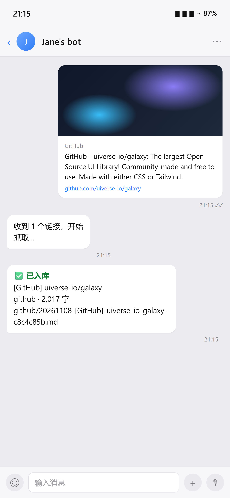
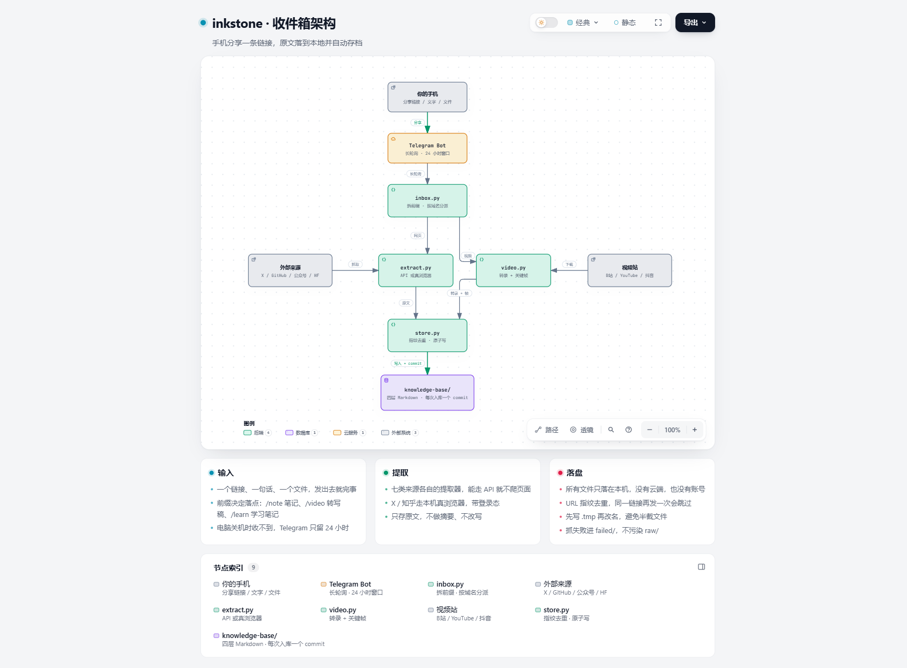

# inkstone

> 砚台。磨墨的地方，记录开始的地方。

手机分享一条链接 → 抓成原文 → 落进本地 Markdown → 自动 git 存档 → 回你一条"已入库"。

A self-hosted inbox for your personal knowledge base. Send a link from your phone, get the
original text on your own disk, versioned with git. No cloud, no account, no model rewriting
the source.

---

## 目录

- [它解决什么问题](#它解决什么问题)
- [它不是什么](#它不是什么)
- [可选：语义检索层](#可选语义检索层)
- [30 秒看效果](#30-秒看效果)
- [快速开始](#快速开始)
- [它怎么工作](#它怎么工作)
- [支持哪些来源](#支持哪些来源)
- [视频流水线：为什么不是"抽几帧"](#视频流水线为什么不是抽几帧)
- [国内用户：飞书能不能替代 Telegram](#国内用户飞书能不能替代-telegram)
- [电脑关机了怎么办](#电脑关机了怎么办)
- [踩过的坑](#踩过的坑)
- [目录结构](#目录结构)
- [备份到私有仓库](#备份到私有仓库)
- [配置](#配置)
- [常见问题](#常见问题)
- [限制](#限制)
- [缘起与致谢](#缘起与致谢)

---

## 它解决什么问题

### 大多数知识库不是死于懒惰，是死于摩擦

搭知识库的人，开头几天兴致都很高：先花两三个小时研究别人的工作流，建好"工作/学习/生活"三个文件夹，再细分技术栈、项目复盘、读书笔记，挑一套好看的字体和暗黑主题。看着文件列表慢慢变长，觉得自己的知识体系马上就要建立起来了。

然后一个月后，打开次数越来越少，最后停在一堆空文件夹上。

不是坚持不坚持的问题，是三个卡点：

1. **收藏太容易，读的成本太高。** 手机上点一下收藏只要一秒，真读懂一篇长文要四十分钟。收藏夹越积越多，每次打开都像看一笔还不清的债，最后干脆不看了。
2. **整理规矩太多，把随手记的冲动磨没了。** 新建一篇笔记要先想目录、再选标签、再写三条要点、再找旧笔记加双链——等你想完，刚才那个念头已经凉了。
3. **把时间花在排版和分类上，真遇到问题时反而用不上。** 图谱连得再漂亮，写代码时真正要调的还是一段命令、一个参数、一次排障记录。找这些，全局搜索永远比顺着图谱点更快。

**记录的阻力一旦大于灵感或踩坑的那一瞬间，知识库就失去了最核心的捕获能力。**

### 形式大于内容的陷阱

这两年最火的两条路线是 Obsidian 加一堆插件，和 LLM Wiki（让 AI 维护一个 wiki 层）。它们都很好，但都有一个共同的坑：**给人一种"做出来会很有成就感"的想象**。

插件装完、图谱连起来、主题调到满意，那一刻的满足感是真实的——但它来自"看起来像个系统"，不是"里面真的有东西"。很多人别说一百条，写到几十条就不想动了。因为维护这个系统本身变成了工作。

我们想要的恰好相反：**填充要极其简单，展示要极其简单，随心所欲地存。**

### 所以只剩三条原则

| 原则 | 具体做法 | 换来了什么 |
|---|---|---|
| **随手丢，零决策** | 一个链接、一句话、一个文件，发出去就完事，不选目录不打标签 | 捕获阻力接近零 |
| **只存原文** | 抓下来的是作者原文，不做摘要、不改写 | 能读原始；和 AI 讨论时不丢细节 |
| **极简展示** | 就四层目录 + 纯 Markdown，靠全局搜索找东西 | 十年后还能用记事本打开 |

第二条值得多说一句。摘要看起来省时间，实际上是把"取舍"这一步提前替你做了，而且做得不可逆——代码里的参数、实验数据、边界条件，恰恰是最容易被摘要吃掉的部分。等你真要排错时，二手总结救不了你。

原文还有一个好处：**它是可核查的**。三个月后你看到一段话，能确认这是作者原话，而不是某个模型润色过的版本。这条底线一旦破了，整个库的可信度就没了。

---

## 它不是什么

划清边界，省得互相耽误：

- **不是笔记软件。** 没有编辑器、没有图谱、没有双链、没有移动端 App。写作请用 VS Code、Obsidian、Typora 或任何你顺手的编辑器。
- **不做摘要。** 你可以让 AI 读它，但不许 AI 改它。
- **本体不做索引，不是 RAG。** 默认检索就是文件系统 + 全文搜索（`rg` / 编辑器搜索），足够处理几万篇。想要"记不清词也能搜到"，可以另接一层可丢弃的语义索引，见[下文](#可选语义检索层)。
- **不负责同步。** 多端同步、备份、历史版本，全部交给 git。
- **不是 SaaS。** 没有服务器，没有账号，所有东西都在你自己的硬盘上。

---

## 可选：语义检索层

本体的检索只有一种：全局搜索。但 `rg` 有个前提——**你得记得那个词**。

记得「agent 的记忆存在哪」，搜 `记忆` 就能命中；只记得「好像有篇文章讲模型为什么老忘事」，就没辙了，因为原文里可能一个「忘」字都没有。这种"记得有、搜不到"会随库变大而变多。

想补这个洞，可以另接一层 SAG2：它只对 `raw/` 建一份关键词倒排索引，不生成内容、不复制原文、不调 embedding，索引删了随时重建。**事实层不变，索引层可丢弃。**

```bash
npm install -g @zleap-ai/sag
sag add "D:\my-kb\002-references\raw" --types md
sag "视频抽帧为什么不能只按固定间隔" "D:\my-kb\002-references\raw" -m 5
```

装完这个 CLI，还可以 `sag install opencode`（或 `claude-code` / `codex`），让 agent 自己搜、自己答，不用再给 SAG 配一个 LLM。

四条边界（JEV 是硬依赖、它不会说"没找到"、片段会外发、会往目录里写 `.sagignore`）和实测数据，见 [`docs/sag-layer.md`](docs/sag-layer.md)。

---

## 30 秒看效果



手机端：分享 → 选 Telegram → 发给自己的 bot。电脑上得到的是一个普通的 Markdown 文件：

```
✅ 已入库
[GitHub] uiverse-io/galaxy
github · 2,017 字
github/20261108-[GitHub]-uiverse-io-galaxy-c8c4c85b.md
```

电脑上得到的是一个普通的 Markdown 文件：

```markdown
---
url: https://github.com/uiverse-io/galaxy
title: '[GitHub] uiverse-io/galaxy'
source: github
author: uiverse-io
fetched_at: '2026-11-08T00:55:00+08:00'
fetched_via: gh-api
chars: 2017
stars: 9642
language: TypeScript
---

# [GitHub] uiverse-io/galaxy

> The largest Open-Source UI Library! ...
```

同时自动跑了一次 `git commit`。抓错了、删错了，都能回到上一版。

---

## 快速开始

### 0. 前置

| 要什么 | 什么时候需要 | 怎么装 |
|---|---|---|
| Windows 10+ / Python 3.11+ / git | 必需 | 官网 |
| Telegram bot | 必需 | 找 @BotFather，`/newbot`，拿 token |
| [ego-browser](https://github.com/citrolabs/ego-lite) | 抓 X、知乎、小红书 | 见项目说明，需先登录对应网站 |
| [gh](https://cli.github.com/) | 抓 GitHub | 装完 `gh auth login` |
| ffmpeg | 只有视频需要 | `winget install ffmpeg` 或官网 |

> 不想装 ego-browser 也能用，只是 X / 知乎 / 小红书这三类会失败。GitHub、公众号、普通网页、视频不依赖它。

### 1. 装依赖

用 [uv](https://docs.astral.sh/uv/)——一个 Rust 写的 Python 包管理器，装一次，之后一条命令：

```bash
git clone <这个仓库>
cd inkstone

uv sync                 # 核心
uv sync --extra video   # 视频（可选）
```

`uv.lock` 已经把版本钉死，换机器也是同一套依赖。

不想装 uv 也能用 pip：

```powershell
python -m venv .venv
.venv\Scripts\activate
pip install -r requirements.txt
pip install -r requirements-video.txt
```

### 2. 建 bot 拿 token

Telegram 里找 `@BotFather` → `/newbot` → 起名字 → 拿一串
`123456789:AAH...`。**这串等于密码，不要发给任何人。**

### 3. 填配置

```powershell
copy .env.example .env
notepad .env
```

至少填 `TOKEN`、`PROXY`、`CHAT_ID`、`KB_ROOT`。`CHAT_ID` 第一次跑起来后，
给 bot 发一句话，日志里会打印出来。

### 4. 建库

把 `template/` 复制成你的知识库目录：

```powershell
copy -Recurse template D:\my-kb
git -C D:\my-kb init -b main
```

四层目录各有 README，根目录的 `AGENTS.md` 是写给 AI 看的规矩（`raw/` 只读那条就在里面）。

### 5. 跑起来

```bash
uv run inbox.py
```

用 pip 的话就是 `python inbox.py`。

给它发一条链接试试。Windows 想开机自启，把 `start-inbox.vbs` 的快捷方式
放进 `shell:startup`。

---

## 它怎么工作



> 可交互版本：[`docs/architecture.html`](docs/architecture.html)，下载后用浏览器打开，有节点详情和路径高亮。

模块各管一件事：

| 文件 | 职责 |
|---|---|
| `inbox.py` | 收消息、拆前缀、分派、回执、后台队列 |
| `sources/` | 一个来源一个文件：`x` / `zhihu` / `weibo` / `wechat` / `github` / `huggingface` / `arxiv` / `xiaohongshu` / `web` |
| `video.py` | 视频下载、转写、选帧、生成笔记 |
| `store.py` | 命名、去重、YAML、原子写、git commit |
| `tg.py` / `feishu.py` | 两个输入通道 |

加一个新来源只要两步：在 `sources/` 下新建一个文件（暴露 `match(url)` 和 `fetch(url)`），
再在 `sources/__init__.py` 的 `_SOURCES` 里加一行。路由、墙检测、落盘都不用动。

设计上只有一个硬约束：**任何一步都不许改原文**。

---

## 支持哪些来源

| 来源 | 走什么 | 坑 |
|---|---|---|
| X 推文/长文 | ego-browser 真浏览器 | 必须登录；长文正文在 `twitterArticleReadView` 里 |
| GitHub 仓库/issue/PR | `gh api` | 需要 `gh auth login`；比爬页面稳得多 |
| 知乎 | ego-browser 真浏览器 | 官方开放平台只返回摘要，存不了原文，所以走浏览器；要先点开"阅读全文"，否则只抓到前几段 |
| 微信公众号 | requests + trafilatura | 静态页，最好抓的一类 |
| B站/YouTube 视频 | yt-dlp + 字幕/Whisper + OCR 选帧 | 字幕常要登录；CPU 转写慢 |
| 抖音视频 | yt-dlp（需 cookies.txt） | 不带 fresh cookies 直接失败；短链会自动展开 |
| 快手 / Vimeo | yt-dlp | 按通用视频处理，不保证每个链接都能下 |
| Hugging Face Space | HF API + README | 页面本体是 iframe，抓的是 README 和元信息 |
| 小红书 | ego-browser 真浏览器 | 要登录；`xsec_token` 会过期；图文笔记正文往往只有几句话 |
| 微博 | ego-browser（m.weibo.cn） | 访客系统会拦直连，必须走真浏览器 |
| arXiv 论文 | 官方 API + PDF 抽全文 | 只支持 arXiv；知网/期刊不做 |
| 其他网页 | requests + trafilatura | 抽不到正文时自动退回真浏览器再试一次 |

判断抓没抓全很简单：看回执里的字数。技术长文低于 1000 字基本就是被拦了，
文件头部会带 `incomplete: true`，失败的原始记录在 `002-references/failed/`。

程序还会识别"假正文"——页面被拦时会返回页脚、法律声明、"请打开 App 查看"这类文字，
这些一律判失败，不会污染库。

---

## 视频流水线：为什么不是"抽几帧"

这一段是这个项目里返工最多的地方，值得完整写下来。

### 起点：BiliNote 不够用

最早用的是 [BiliNote](https://github.com/JefferyHcool/BiliNote)，一个能出图文笔记的桌面应用。
问题有两个：一是**要开软件、手动上传**，没法接进"发链接就完事"的流程；二是**截图不准**。

它的候选帧来自"每秒密集采样 + 场景变化检测"，画面一变就进候选——转场、人物走动、镜头切换都会触发。
后面虽然把候选拼成网格交给多模态模型挑，但候选本身没有先做文字密度和知识点去重，
结果就是"画面变了"被当成"内容变了"，教程视频里截出一堆无关帧。

### 调研：五个项目，两种路线

| 项目 | 形态 | 关键帧能力 | 输出 |
|---|---|---|---|
| BiliNote | 桌面应用 | 1 秒密集采样 + 场景检测 + VLM 挑图 | 成品 Markdown |
| BiliSum（lycohana，约 646★） | CLI | B站优先，截图跟随段落，支持 VLM | Markdown / Obsidian |
| claude-real-video / crv（约 2.3k★，MIT） | CLI / MCP | 场景变化 + 三通道去重 + `--text-anchors` 文字锚点 | frames + transcript + MANIFEST |
| claude-video / `watch`（约 20k★，MIT） | Agent skill | 本地抽帧 + 转写，可选 Gemini 整段看 | 交给 agent 写 |
| lecture-to-notes（约 57★） | CLI + skill | 幻灯片提取 + OCR + VLM + 时间对齐 | Markdown + HTML |

调研完之后路线很清楚：**一类是"直接出成品笔记"，一类是"只出证据包，笔记交给 agent 写"。**

我们选了后者。原因很直接——成品笔记的"总结"是别人替你做的取舍，而取舍恰恰是最不该外包的一步。
证据包则相反：原文、时间戳、原始截图都在，你想怎么读、让谁读都行。

### 结论：关键帧不能只靠"固定间隔"

固定 10 秒抽一帧的毛病很明显：讲重点的那 8 秒可能刚好被跳过，而一张空白的过渡画面反而被留下。

真正有用的是三件事：

1. **场景变化**——翻页、切屏、演示切换
2. **OCR 文字密度**——教程视频里，代码、公式、终端输出在变，画面差异其实很小，场景检测抓不到
3. **去重 + 时间戳**——不漏帧，且每张都能跳回原片

### 我们最后做的

```
平台字幕优先 → 没有字幕才本地 Whisper
      ↓
候选帧三种来源：每 8–20 秒固定间隔、场景变化点、每段转写的起点
      ↓
打分：OCR 文字密度（排除底部字幕/台标/水印）、场景差、清晰度、文字新颖度
      ↓
去重：dHash + 文本相似度，同一页只留一张
      ↓
按时间分桶各选一张，再按分数补齐（8 / 16 / 22 / 28 张，视时长）
      ↓
transcript.md / transcript.txt / note.html / frames/ / meta.json
```

产出物：

| 文件 | 用途 |
|---|---|
| `transcript.md` | 带时间戳和截图的 Markdown，适合在库里读 |
| `transcript.txt` | 纯文本，直接复制给 AI 做总结/问答 |
| `note.html` | 自包含 HTML（图片是压缩预览，手机看最方便） |
| `frames/` | 关键画面母版（默认最长边 1080） |
| `meta.json` | 元信息 + 选帧记录 |

`frames/` 是母版，`note.html` 里只嵌 900px、质量 68 的预览图，避免同一张图存两份全尺寸。
不想要 HTML 就设 `VIDEO_HTML=0`，Telegram/飞书会改发 `transcript.md`。

第一次跑通用的是 3 分半的 B 站教程：CPU 上约 2 分 45 秒，转录 1,287 字，选出 8 张关键画面。

**不生成摘要。** 转录就是原文，要不要总结、让谁总结，是你的事。

视频任务在后台单线程排队，不会卡住 Telegram 轮询。CPU 上 20 分钟的视频大约要 10–20 分钟。

> B站导出的字幕比 ASR 准得多。装个浏览器扩展导出 `cookies.txt`，设 `VIDEO_COOKIES=<路径>`，
> 会优先拿 AI 字幕。抖音没有 cookie 完全没有稳定路径。

---

## 国内用户：飞书能不能替代 Telegram

能。Telegram 和飞书现在是同一层的两个通道：收消息各管各的，拆前缀、抓取、视频排队、落盘、
回执全部走 `channels.py` 的同一套逻辑。

| | Telegram | 飞书 |
|---|---|---|
| 网络 | 必须挂代理 | 国内直连 |
| 收消息方式 | 长轮询（要连 api.telegram.org） | 事件订阅长连接，不需要公网 IP、不需要域名 |
| 关机期间的消息 | 服务器只留 24 小时，过期永久丢失 | 群里发的消息可以按时间范围拉回来 |

第三行是关键差异。Telegram Bot API 没有任何"读历史"的接口，`getUpdates` 只给 24 小时内的。
飞书的 `im/v1/messages` 能按时间范围拉某个群的聊天记录——**只要机器人还在群里，关机三天再开机也能补收**。

所以国内版的正确用法不是"私聊机器人"，而是**建一个只有你和机器人的群，把链接转发到群里**。
群就是队列。

代价：需要一个飞书企业（免费建一个只有自己的就行），在开放平台建自建应用、开权限、配长连接。
第一次配置大约 15 分钟，比 BotFather 麻烦，但配完不用管。

**两种跑法**：

- 只跑飞书：`.env` 里只填 `FEISHU_APP_ID` / `FEISHU_APP_SECRET`，`TOKEN` 留空。
- 两个都跑：`TOKEN` 和飞书两个键都填，两个入口共用同一套抓取与落盘。

### 配置步骤（约 15 分钟）

1. 打开 [open.feishu.cn](https://open.feishu.cn)，用飞书账号登录（没有企业就免费建一个）
2. 创建企业自建应用 → 「添加应用能力」→ 开启**机器人**
3. 权限管理加三个：`im:message`、`im:message:send_as_bot`、`im:chat:readonly`
4. 事件订阅 → 选**长连接** → 添加事件 `im.message.receive_v1`
5. 版本管理与发布 → 创建版本 → 发布（自己是管理员就直接通过）
6. 把 App ID / App Secret 填进 `.env`，重启收件箱

然后把机器人拉进一个群，**在群里发链接**——群就是队列，关机期间的消息可以在开机后补拉。

飞书通道支持文字、链接、文件、图片和视频。视频和 Telegram 共用同一个单线程队列；
`note.html` / `transcript.txt` 通过飞书的文件上传接口发回群里。文件太大时只发文字回执，
路径仍然在库里。

---

## 电脑关机了怎么办

先把话说清楚：**程序不在跑的时候，它收不到任何东西。**

| 情况 | Telegram | 飞书 |
|---|---|---|
| 程序在跑 | 正常 | 正常 |
| 电脑开着，程序没跑 | 24 小时内开机可补收 | 开机后拉历史补收 |
| 关机不到 24 小时 | 开机自动补收 | 开机后拉历史补收 |
| 关机超过 24 小时 | **链接永久丢失** | 照样能补收 |
| 收到了但抓取中断 | 留在 `failed/`，需手动重跑 | 同左 |

飞书的补收是开机时自动做的：启动先拉一遍群历史，把上次运行之后的消息过一遍，
处理完再连实时长连接。日志里会打印 `[feishu] 补收 …`。

**现在的补救办法**（Telegram）：

1. 打开和 bot 的聊天，往上翻，看有哪些链接没收到"已入库"回执；
2. 把它们重新发一次。已经入库的会自动跳过（URL 指纹去重），不会产生重复文件；
3. 抓到一半失败的，看 `002-references/failed/`，里面每条都有 URL 和错误原因。

> 启动时还会检查 `failed/`：如果有未处理的抓取失败，会主动给你发一条汇总，
> 附 URL 和错误原因。目前只发汇总，不自动重跑。

---

## 踩过的坑

这些都是真实发生过的，写下来省得你重踩：

**1. 代理只给了 Telegram，忘了抓取。**
`.env` 里的 `PROXY` 一开始只被 Telegram 收发用，`requests` 和 `gh` 都在直连，结果
HuggingFace 和 GitHub API 全部超时。修复方式是在 `load_env()` 里把 `PROXY` 同时导出成
`HTTP_PROXY` / `HTTPS_PROXY`，让所有走标准库的请求都自动带上。

**2. 回执超时 ≠ 没入库。**
有一次抓取和 commit 都成功了，但 Telegram 回执发送超时，界面上什么都没显示。
后来学乖了：状态以 git log 和文件为准，不以聊天窗口为准。

**3. 假正文比抓取失败更危险。**
小红书被拦时返回的是页脚 + 法律声明 + "请打开 App 查看"，八百多字，看起来像成功了。
现在有墙检测：命中"当前笔记暂时无法浏览""环境异常"这类特征，直接判失败进 `failed/`。

**4. 抖音没有 cookie 就没有稳定路径。**
`yt-dlp` 会直接报 `Fresh cookies (not necessarily logged in) are needed`。
导出一次 `cookies.txt` 能撑几天到几周；想省事就用 Firefox 登录抖音，
设 `VIDEO_COOKIES_FROM_BROWSER=firefox`，让它每次自己读。

**5. Windows 的 `.vbs` 不能写中文注释。**
脚本按 ANSI 解析，UTF-8 中文会把注释行读坏，连下一行的 `Set` 都被吞掉，
表现为"开机自启没反应"。注释改成英文就好了。

**6. `409 Conflict` 表示有两个实例在收消息。**
之前那个没退干净，或者你开了两个窗口。

---

## 目录结构

```openui-lang
root = Stack([t])
t = Table(["目录", "放什么", "谁写"], [["001-inbox/", "随手念头、碎片原话", "你"], ["002-references/raw/", "一手原文，按来源分 x/github/zhihu/wechat/video/web", "程序"], ["002-references/files/", "你直接发过来的 PDF / Word", "程序"], ["002-references/failed/", "抓取失败记录，附 URL 和原因", "程序"], ["003-notes/", "你自己想明白的、准备输出的内容", "你"], ["004-archive/", "已公开发布的内容 + 读者反馈", "你"]])
```

一句话：**002 是别人说的，003 是你说过的，001 是还没想清楚的，004 是已经说出去的。**

根目录的 `AGENTS.md` 是给 AI 的规矩，最重要的一条是 `raw/` 只读——
原文一旦被改写，就再也无法核查了。

---

## 备份到私有仓库

知识库本身就是一个 git 仓库。建一个**私有**仓库，配好远端之后，每次入库都会自动 push：

```bash
git -C "D:\my-kb" remote add origin <私有仓库地址>
git -C "D:\my-kb" push -u origin main
```

没网时 push 会静默失败，下一次提交自动补上——本地永远不受影响。设 `AUTO_PUSH=0` 可以关掉。

手机装 GitHub App 就能直接读库里的文章，通勤时看比开电脑方便。

## 配置

`.env` 里的项：

| 键 | 作用 |
|---|---|
| `TOKEN` | Telegram bot token；只跑飞书可留空 |
| `PROXY` | 代理地址，Telegram 和抓取共用 |
| `CHAT_ID` | 给你自己发通知用的会话 id |
| `FEISHU_APP_ID` | 飞书自建应用 App ID；填了才启用飞书通道 |
| `FEISHU_APP_SECRET` | 飞书自建应用 App Secret |
| `KB_ROOT` | 知识库根目录 |
| `VIDEO_COOKIES` | 浏览器导出的 cookies.txt 路径（B站/抖音） |
| `VIDEO_COOKIES_FROM_BROWSER` | 直接从浏览器读 cookie，如 `firefox` |
| `WHISPER_MODEL` | `small`（默认）/ `medium`（更准更慢） |
| `WHISPER_LANG` | 如 `zh`，跳过语言检测 |
| `WHISPER_BEAM` | Whisper beam size，默认 5；调大更准更慢 |
| `VIDEO_MAX_DURATION` | 长视频上限，默认 7200 秒 |
| `VIDEO_MAX_FRAMES` | 强制关键帧数量 |
| `VIDEO_SCENE_THRESHOLD` | 场景变化灵敏度，默认 0.30 |
| `VIDEO_FRAME_MAX_WIDTH` | 关键帧母版最长边，默认 1080 |
| `VIDEO_FRAME_QUALITY` | 关键帧 JPEG 质量，默认 84 |
| `VIDEO_HTML` | 是否生成自包含 `note.html`，默认 1；设 0 不生成 |
| `VIDEO_HTML_MAX_WIDTH` | HTML 内嵌预览图最长边，默认 900 |
| `VIDEO_HTML_QUALITY` | HTML 内嵌预览图质量，默认 68 |

---

## 开发与测试

代码分三层：

- `channels.py`：通道无关的意图（`/learn`、链接、前缀、随手记）和视频队列。
- `inbox.py` / `feishu.py`：只负责收消息、发消息；新通道实现 `send_text` / `send_file` 即可。
- `store.py`：命名、去重、frontmatter、原子写、git。

测试不联网、不碰真实知识库：

```powershell
.venv\Scripts\python.exe -m unittest discover -s tests -v
```

`manage.py` 是知识库维护命令：

```powershell
python manage.py drop <路径|URL> --reason "..."   # 删 raw 并留记录
python manage.py check                            # 体检
python manage.py install-hooks                    # 启用 raw 只读钩子
```

---

## 常见问题

| 现象 | 原因 |
|---|---|
| `ego-browser 退出码 1` | 浏览器服务没起来，或页面 20 秒内没加载完 |
| `gh api 失败：401` | `gh auth login` 过期了 |
| 知乎只抓到几百字 | 没登录，或那条回答本身很短 |
| `409 Conflict` | 有两个 inbox.py 在同时收消息 |
| `ConnectTimeout` / `TLS handshake timeout` | 代理没起来，或 `.env` 里的 `PROXY` 不通 |
| 抓到的 X 是登录页 | ego 浏览器里没有 X 的登录态，手动登录一次 |
| 视频转写很慢 | CPU 跑 Whisper，20 分钟视频约 10–20 分钟，属正常 |

---

## 限制

- **Windows 优先。** 抓取和视频管线是跨平台的，但开机自启脚本是 `.vbs` / `.ps1`，Linux/macOS 需要自己换。
- **Telegram 必须挂代理；飞书不用。** 只跑飞书就把 `TOKEN` 留空，别为了启动去挂梯子。
- **X / 知乎 / 小红书需要登录态。** 用的是本机真实浏览器，不是接口。
- **小红书基本不可用。** 图文笔记正文太短，纯文本存档意义不大。
- **知网、期刊论文不支持。** 付费墙 + 登录，建议只存链接和摘要。
- **不做 OCR 之外的图像理解。** 截图存下来，看不看、怎么用，交给你和 AI。

---

## 缘起与致谢

这个项目起于 [@realchendahuang](https://x.com/realchendahuang) 的一篇长文
《Git + Wu + Hermes + Ego Lite：我的个人知识库方案》——它把"知识库为什么吃灰"这件事说得很透，
也给了"本地 Markdown + Git + 真浏览器抓取"的骨架。

我们在这套骨架上改了三件事：

- **把 Hermes 换成自研脚本。** 捕获这条链路不需要 Agent，域名路由 + 提取器就够了，更快也更可控。
- **从一个源扩到多个源。** 加了 GitHub、知乎、公众号、HF、视频。
- **补了视频管线。** 参考 BiliSum、crv、claude-video、lecture-to-notes 的做法，取"证据包"路线。

视频部分特别感谢 [claude-real-video (crv)](https://github.com/HUANGCHIHHUNGLeo/claude-real-video)
的 `--text-anchors` 思路——在转写段落起点补帧，是教程视频选帧质量提升最大的一步。

---

## License

MIT
